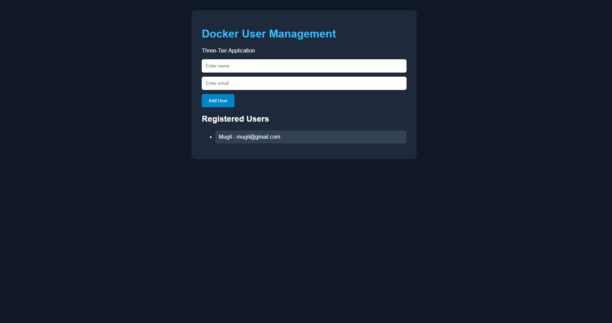
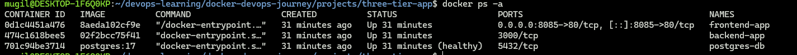
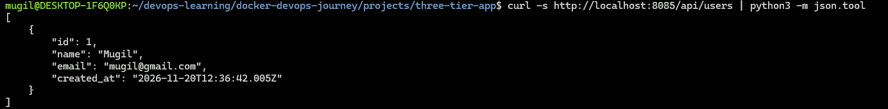

# Three-Tier Docker Application

A containerized three-tier web application built using **Node.js, Express, PostgreSQL, Nginx, and Docker Compose**.

This project demonstrates how to build, connect, and run multiple application services using Docker containers, custom networks, persistent volumes, and Nginx reverse proxy.

---

## 📌 Project Overview

The application follows a three-tier architecture:

1. **Presentation Layer:** Frontend built with HTML, CSS, JavaScript, and Nginx.
2. **Application Layer:** Backend REST API built using Node.js and Express.
3. **Database Layer:** PostgreSQL database for persistent data storage.

The frontend communicates with the backend through Nginx, while the backend connects to PostgreSQL using Docker's internal network.

---

## 🏗️ Architecture

```text
             USER / BROWSER
                    |
                    |
             http://localhost:8085
                    |
                    v
          +---------------------+
          |    FRONTEND         |
          |   Nginx + HTML      |
          |   CSS + JavaScript  |
          +---------------------+
                    |
                    | /api/
                    v
          +---------------------+
          |      BACKEND        |
          |   Node.js + Express |
          |      REST API       |
          +---------------------+
                    |
                    | PostgreSQL connection
                    v
          +---------------------+
          |      DATABASE       |
          |     PostgreSQL      |
          +---------------------+
                    |
                    v
             Persistent Volume
```

---

## 🛠️ Technologies Used

| Technology | Purpose |
|---|---|
| Docker | Containerization |
| Docker Compose | Multi-container orchestration |
| Nginx | Frontend web server and reverse proxy |
| Node.js | Backend runtime |
| Express.js | REST API development |
| PostgreSQL | Relational database |
| HTML, CSS, JavaScript | Frontend development |
| Git & GitHub | Version control |

---

## 📂 Project Structure

```text
three-tier-app/
│
├── backend/
│   ├── .dockerignore
│   ├── Dockerfile
│   ├── package.json
│   ├── package-lock.json
│   └── server.js
│
├── frontend/
│   ├── Dockerfile
│   ├── index.html
│   ├── style.css
│   ├── app.js
│   └── nginx.conf
│
├── screenshots/
│   ├── UI.png
│   ├── Docker-container.png
│   └── API_Response.png
│
├── .env.example
├── .gitignore
├── docker-compose.yml
└── README.md
```

---

## ⚙️ Application Features

- Three-tier application architecture.
- Separate Docker containers for frontend, backend, and database.
- Nginx reverse proxy for backend API requests.
- REST API for registering and retrieving users.
- PostgreSQL persistent storage using Docker volumes.
- Docker custom bridge network for service communication.
- Environment variables for database configuration.
- PostgreSQL health check.
- Docker Compose for managing the complete application.

---

## 🚀 How to Run the Project

### Prerequisites

Install the following tools:

- Docker Engine
- Docker Compose plugin
- Git

### Step 1: Clone the repository

```bash
git clone https://github.com/Mugilshabari/docker-devops-journey.git
```

### Step 2: Navigate to the project directory

```bash
cd docker-devops-journey/projects/three-tier-app
```

### Step 3: Configure environment variables

Create your environment file:

```bash
cp .env.example .env
```

Open the file:

```bash
nano .env
```

Update the database credentials. Make sure the PostgreSQL and backend database credentials match.

**Note:** Never commit your actual `.env` file to GitHub.

### Step 4: Build and start the containers

```bash
docker compose up -d --build
```

### Step 5: Check running containers

```bash
docker compose ps
```

The application contains three main services:

- frontend_app
- backend
- postgres

### Step 6: Access the application

Open your browser:

**Frontend URL:** http://localhost:8085

### Step 7: Test the API

Retrieve registered users:

```bash
curl -f http://localhost:8085/api/users
```

For formatted JSON output:

```bash
curl -s http://localhost:8085/api/users | python3 -m json.tool
```

---

## 📸 Project Screenshots

### 1. Frontend User Interface

The frontend displays the user registration interface and registered users.



### 2. Docker Containers

All three application services running as Docker containers.



### 3. Backend API Response

The REST API successfully retrieves user records from PostgreSQL.



---

## 🐳 Useful Docker Commands

| Command | Description |
|---|---|
| `docker compose up -d` | Start all services |
| `docker compose up -d --build` | Rebuild and start services |
| `docker compose ps` | View service status |
| `docker compose logs -f` | View application logs |
| `docker compose logs backend` | View backend logs |
| `docker compose restart` | Restart services |
| `docker compose down` | Stop and remove containers and network |
| `docker volume ls` | List Docker volumes |
| `docker network ls` | List Docker networks |

**Important:** Avoid `docker compose down -v` when you want to preserve PostgreSQL data.

---

## 🔐 Security Considerations

- Environment files containing credentials are excluded from Git.
- `.env.example` provides placeholder configuration.
- Database credentials should be kept private.
- PostgreSQL is accessible internally through the Docker network.
- The backend and database do not need public host port mappings for normal frontend access.

---

## 📚 What I Learned

Through this project, I gained practical experience with:

- Building custom Docker images using Dockerfiles.
- Running multiple services using Docker Compose.
- Connecting containers through custom bridge networks.
- Using Nginx as a reverse proxy.
- Integrating Node.js with PostgreSQL.
- Persisting database data with Docker volumes.
- Managing environment variables securely.
- Testing REST APIs using cURL.
- Troubleshooting container and database connectivity.

---

## 👨‍💻 Author

**Mugil**

GitHub: [@Mugilshabari](https://github.com/Mugilshabari)

Project Repository: [Docker DevOps Journey](https://github.com/Mugilshabari/docker-devops-journey)

---

*Part of my hands-on Docker and DevOps learning journey.*
